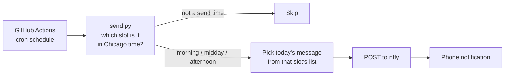

# Workday Motivation Notifier


A small automation that sends a motivational push notification to my phone three times every workday: a morning boost, a lunchtime check-in and an afternoon "home stretch" message. It runs entirely on **GitHub Actions** on a schedule, so no computer has to stay on, and it delivers through the free [ntfy](https://ntfy.sh) push-notification service.

I built it to break up long workdays with a reminder to eat, stretch, take a breath or just keep going.

## How it works



- **Three time slots:** 9:07am, 12:07pm and 3:37pm (America/Chicago), Monday to Friday. Each slot has its own set of messages in `messages.txt`, grouped under `[morning]`, `[midday]` and `[afternoon]`. For example, "made it to lunch" jokes only arrive at noon.
- **Daylight saving time:** GitHub's scheduler only understands UTC, and Chicago is UTC−5 in summer and UTC−6 in winter. Each slot is scheduled at *both* UTC times, and `send.py` converts the current time to Chicago time and only sends from the run that lands in that slot's 55-minute window. This works all year without editing the schedule.
- **No repeats:** each slot's messages are shuffled with a fixed seed per cycle and handed out one per *workday*, so every message is used once before any repeats, and weekends don't use one up. The same day always gives the same message, so re-running a job never sends a different one.
- **Secrets:** the ntfy topic acts as a password, so it's stored as an encrypted GitHub Actions secret, never in the code.
- **Dependencies:** none. It uses only the Python standard library (`urllib`, `zoneinfo`, `json`).

## Tests

`tests/test_send.py` runs on every push (see the badge above) and checks that:
- every scheduled UTC run sends each slot **exactly once** in both summer (CDT) and winter (CST)
- late runs inside the window still send, and runs outside it or on weekends don't
- a full cycle uses every message exactly once
- the same day always picks the same message

```bash
python -m unittest discover -s tests -v
```

## Use it yourself

1. Install the **ntfy** app on your phone and subscribe to a hard-to-guess topic name, for example `motivate-` followed by random characters.
2. Fork this repo, then add a repository secret named `NTFY_TOPIC` with that topic name (**Settings → Secrets and variables → Actions**).
3. Edit `messages.txt`, and change `TIMEZONE` and `SLOTS` in `send.py` if needed, along with the matching cron lines in `.github/workflows/send.yml`.
4. Test it with **Actions → Send motivation → Run workflow**.

Without the secret, the scheduled job just logs a note and exits.
